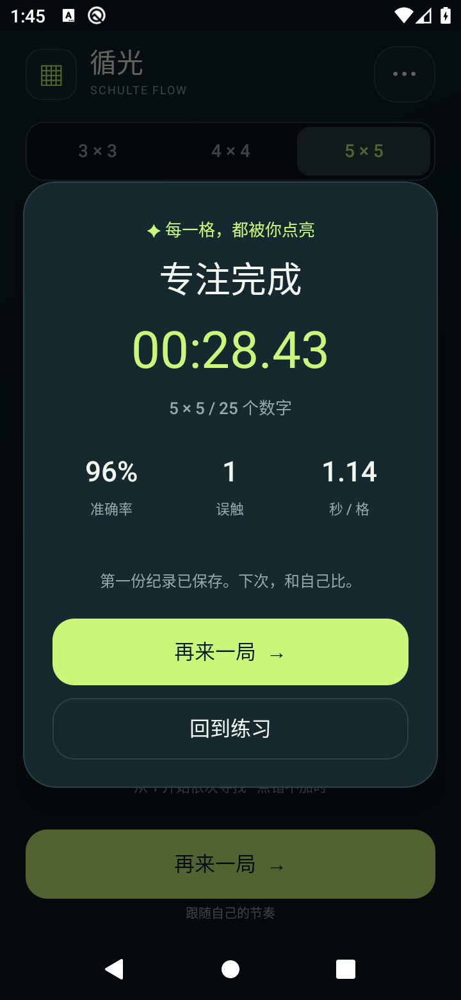

# 循光 · 舒尔特表

一款专注点按反馈的轻量原生 Android 应用。深色界面，青柠色目标，柔和递进音效与弹性动效。无需网络或账号，数据只保存在本机。

[下载 APK（v1.0.0 Release）](https://github.com/azfiles/apkGo/releases/tag/v1.0.0) · [构建与测试](https://github.com/azfiles/apkGo/actions/workflows/android.yml)

v1.0.0 已发布：92 项逻辑检查、169 项 Android 10 模拟器 UI 检查及签名/对齐验证全部通过。[查看验证记录](./docs/verification.md)。`dist/` 提供与 Release 完全一致的备用安装包。

 

## 玩法与功能
从 1 开始按顺序点亮数字。提供 3×3、4×4、5×5 三档；点错会提示，不额外加时。连续点对有连击、音阶、回弹和粒子反馈。音效与触感可分别关闭，触感遵循系统设置。

暂停遮住棋盘，后台自动停表，重新打开恢复未完成进度。完成后显示用时、准确率、误触数和平均每格时间；各难度独立保存最佳纪录。

## 安装
Android 8.0（API 26）及以上。下载 Release 中的 `Schulte-Flow-1.0.0.apk` 到手机并打开，按系统提示允许安装即可。APK 不请求网络、存储等权限，不包含广告、统计或第三方运行时依赖。卸载会清除本机成绩。

## 构建
Linux、JDK 17、Python 3 和 Android SDK。安装 `platforms;android-35`、`build-tools;35.0.0`，设置 `ANDROID_SDK_ROOT` 后运行：

```bash
bash build.sh
```

输出为 `build/output/Schulte-Flow-1.0.0.apk`，同时输出 SHA256 校验文件。构建直接使用 Android 官方 AAPT2、D8、zipalign 和 apksigner，无 Gradle 下载依赖。WAV 音效由 Python 程序生成。

## 验证与发布
源码提交会运行 GitHub Actions：状态机测试 → 编译 APK → 签名和对齐验证 → Android 10 模拟器安装与 UI 冒烟 → 发布体验版。也可在 Actions 页面手动运行。失败不发布 Release；日志与截图保存为 Actions artifacts。

UI 测试包含三种尺寸完整通关、真实触摸正确/错误数字、暂停停表、取消重开、Activity 重建恢复、设置与最佳成绩持久化。模拟器测试无法代替实体设备的触感和声音体验。

```bash
mkdir -p build/model
javac -d build/model app/src/main/java/com/alex/schulteflow/GameSession.java tests/GameSessionTest.java
java -cp build/model GameSessionTest
bash tests/build-smoke.sh
bash tests/run-smoke.sh  # 需要已启动且专用于测试的模拟器，会清空本应用成绩
```

## 演示签名
`signing/demo-signing.p12.base64` 是特意公开的演示密钥，密码为 `schulte-demo-public`，别名 `schulte-demo`。固定密钥便于体验版后续覆盖安装。**正式分发请替换为你自行保管的私有签名证书**，不要将生产密钥提交到仓库。

## 结构
- `app/src/main/`：原生 Java UI、可独立测试的游戏状态机、资源
- `scripts/generate_sounds.py`：生成音效
- `tests/`：状态机和设备冒烟测试
- `.github/workflows/android.yml`：构建、测试与 Release 发布
