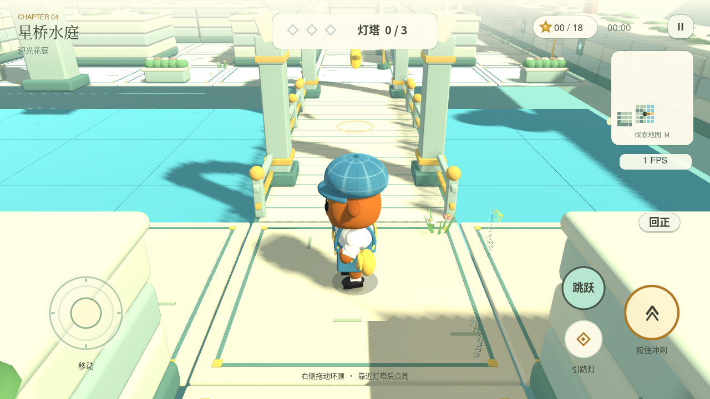

# Pipi Maze · 灯火遗迹 / 第三人称 3D

`apkGo` 集中开发 Godot 第三人称 3D 游戏。0.5.0 新增实时帧率、数据驱动关卡与第四章「星桥水庭」，并保留布朗角色查看、跑跳动作和存档。

[下载 0.5.0 APK](https://github.com/azfiles/apkGo/releases/download/maze-3d-v0.5.0/Pipi-Maze-Ruins-0.5.0.apk) · [已发布版本与模型源文件](https://github.com/azfiles/apkGo/releases/tag/maze-3d-v0.5.0) · [操作与构建](maze3d/README.md) · [验证范围](docs/maze3d/DATA_LEVEL_VERIFICATION.md)



0.5.0 可带着布朗在四章迷宫中探索、跳跃、收集星星、点亮灯塔，新增「星桥水庭」、可关闭的实时帧率显示，以及 Blender → GLB → JSON → Godot 的数据关卡流程。支持触屏摇杆、环顾镜头、冲刺、断桥安全复位、首页 360° 角色查看、动态表情和自动存档。

「星桥水庭」包含五个区域、三处跨水桥、喷泉、凉亭、高架引水渠、18 颗星星与 9 处跳跃挑战。[建模与关卡规范](docs/maze3d/MODELING.md) · [验证与画面](docs/maze3d/DATA_LEVEL_VERIFICATION.md)。

## 开发入口

Godot **4.6.3** 导入 `maze3d/project.godot` 即可运行。Linux：

```bash
bash scripts/maze3d/setup.sh
export GODOT="$PWD/build/godot-tools/bin/godot"
export XDG_DATA_HOME="$PWD/build/godot-tools/data"
bash scripts/maze3d/test.sh
# 需要 JDK 17、Android SDK 35 和 build-tools 35.0.0
bash scripts/maze3d/build.sh
python3 scripts/maze3d/package.py
```

普通提交与 PR 执行不含 Android 模拟器的 Godot 规则/场景检查。完整签名 APK、Android 冒烟、截图和 Release 通过 **Pipi Maze 3D · verified preview** 手动触发，或通过 `release/maze-3d-*` 发布分支触发。已发布包保持不可变，后续同版本验证构建使用新标签；每次修改不自动重复发布。

Android 包名与公开演示签名沿用现有版本，存档继续保存在本机。0.5.0 可覆盖安装旧版本并保留进度；已有 0.4.0 下载保持原始发布文件。

## 项目结构

| 目录 | 用途 |
| --- | --- |
| `maze3d/` | Godot 游戏源码、场景、素材与测试 |
| `scripts/maze3d/` | 引擎安装、模型生成、验证、构建和打包 |
| `model-source/maze3d/` | Blender 源文件与参考 |
| `docs/maze3d/` | 设计、素材来源、实际截图和验证记录 |
| `signing/` | 原有公开演示签名 |

## 已拆分的项目

| 项目 | 独立仓库 | 状态 |
| --- | --- | --- |
| 循光 · 舒尔特表 | [schulte-flow](https://github.com/azfiles/schulte-flow) | 原生与 Godot 版、MIT 开源、独立 APK Release |
| 花园捉迷藏 2.5D | [pipi-maze-garden](https://github.com/azfiles/pipi-maze-garden) | 独立保留源码、素材、构建和历史下载入口 |
| 舒尔特 Unity 原型 | [schulte-flow-unity](https://github.com/azfiles/schulte-flow-unity) | 独立保存，完整构建需 Unity 激活 |

本仓库保留旧提交、分支、标签与 Release 下载链接；新开发以 `main` 为入口。[拆分记录](docs/PROJECTS.md)。布朗及参考立绘的权利说明见 [BROWN](docs/maze3d/BROWN.md)、[ART](docs/maze3d/ART.md)，字体和引擎保留各自许可。
