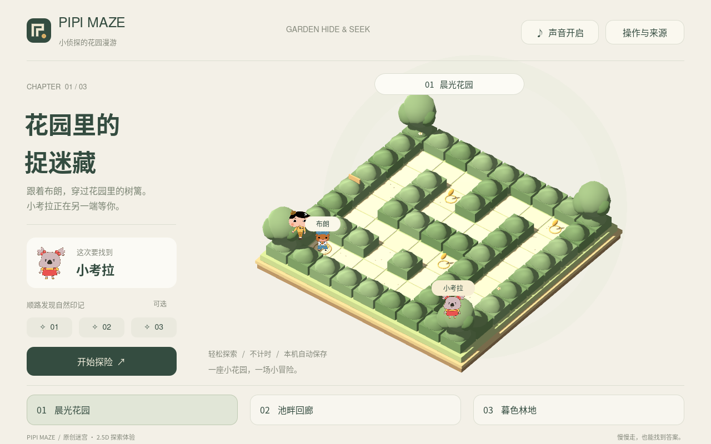
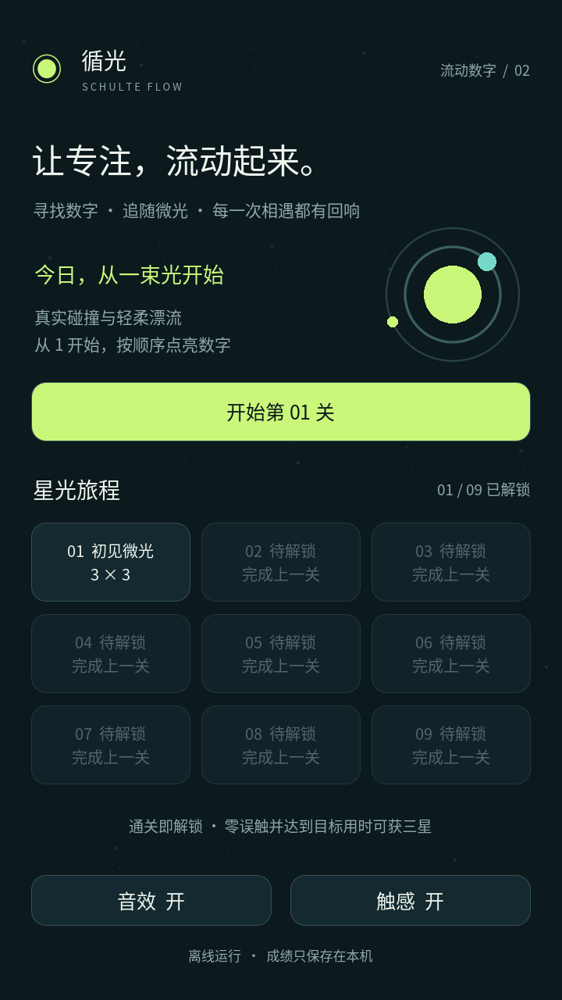
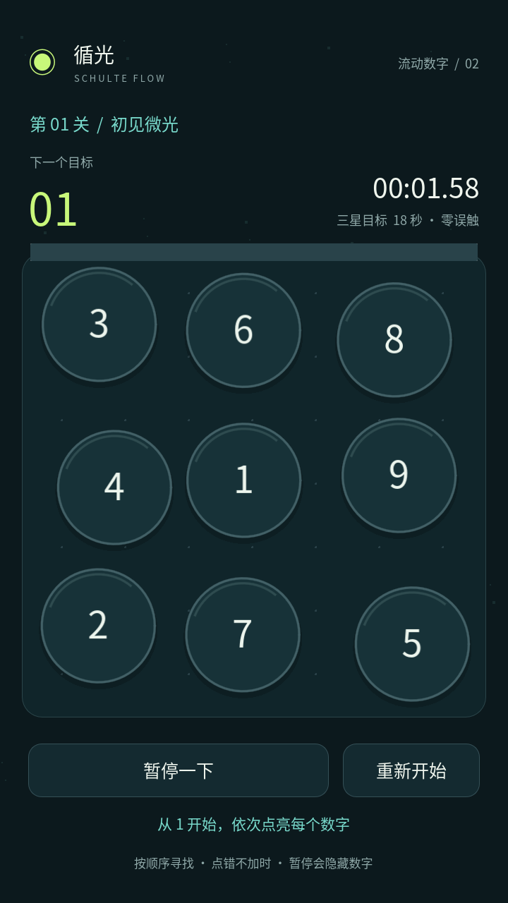

# Pipi Maze · 灯火遗迹 / 第三人称 3D

当前体验版 **0.2.1：布朗角色更新**。依据《屁屁侦探》官方立绘重建布朗，保留三章迷宫、双指移动与环顾、引路、点灯、收集及自动存档。

[下载 Android APK](https://github.com/azfiles/apkGo/releases/download/maze-3d-v0.2.1/Pipi-Maze-Ruins-0.2.1.apk) · [完整发布与模型源文件](https://github.com/azfiles/apkGo/releases/tag/maze-3d-v0.2.1) · [游戏说明](maze3d/README.md) · [布朗参考与模型说明](docs/maze3d/BROWN.md)


## 早期版本：花园捉迷藏 / Godot 2.5D

新增独立的 Godot 迷宫游戏首版 `0.1.0`。复用 `azfiles/pipi-maze` 的布朗、屁屁侦探和小考拉原图，以正交三维花园与纸片角色呈现 2.5D 探索。包含晨光花园、池畔回廊、暮色林地三个可完整通关的关卡，支持点击寻路、方向盘 / 键盘、可选自然印记、提示、暂停和本机保存。

[工程与操作说明](maze-godot/README.md) · [设计文档](docs/maze/DESIGN.md) · [素材来源](maze-godot/ASSET_SOURCES.md)。打开 `maze-godot/project.godot` 即可运行；`bash scripts/maze/test.sh` 验证规则与场景，`bash scripts/maze/build.sh` 输出独立包名的 Android APK 和 Linux 可执行文件。

[下载迷宫试玩版 APK](https://github.com/azfiles/apkGo/releases/download/maze-v0.1.0/Pipi-Maze-Garden-0.1.0.apk) · [完整 Release 与 Godot 工程](https://github.com/azfiles/apkGo/releases/tag/maze-v0.1.0) · [迷宫构建与发布](https://github.com/azfiles/apkGo/actions/workflows/maze-godot.yml)



## 循光 · 流动数字 / Godot 2.0

Godot 版将舒尔特表变成会漂流、碰撞、反弹的数字球：从 1 开始依次点亮数字，穿过 9 个逐步解锁的关卡。点击冲量、碰撞火花、点亮与通关粒子，配合轻柔音阶；支持星级、最佳纪录、暂停、后台停表和本机进度恢复。

[下载 Godot 2.0 APK](https://github.com/azfiles/apkGo/releases/download/godot-v2.0.0-4-bdc250e/Schulte-Flow-Godot-2.0.0.apk) · [Godot 编译、验证与发布](https://github.com/azfiles/apkGo/actions/workflows/godot-android.yml) · [开发与验证说明](docs/godot-development.md)

打开 `godot/project.godot`，使用 Godot 4.6.3。运行 `bash scripts/godot/test.sh` 可验证状态机、真实触摸输入、刚体碰撞、粒子、暂停和 9 关通关。Actions 会额外签名、检查 APK，并在 Android 10 模拟器上安装操作实际发布包，全部通过后才创建独立 Release。

Android 7.0+、OpenGL ES 3.0；ARM64 / ARMv7 / x86_64。独立包名 `com.alex.schulteflow.godot`，与旧版并存，旧版成绩不迁移。离线运行，仅振动权限。沿用公开演示签名，供体验安装。

已发布：[Godot 2.0 体验版](https://github.com/azfiles/apkGo/releases/tag/godot-v2.0.0-4-bdc250e)。368 项逻辑、53 项场景、22 项 Android 安装/操作/画面检查通过；下载成品的 SHA256 与签名已复核。[完整验证记录](docs/godot-verification.md)。

 

## 原生 Java 1.0（保留）

以下为旧版说明。Java 构建工作流现已改为仅手动运行，后续自动编译与发布使用上方的 Godot 工作流。

一款专注点按反馈的轻量原生 Android 应用。深色界面，青柠色目标，柔和递进音效与弹性动效。无需网络或账号，数据只保存在本机。

[下载 APK（v1.0.0 Release）](https://github.com/azfiles/apkGo/releases/tag/v1.0.0) · [构建与测试](https://github.com/azfiles/apkGo/actions/workflows/android.yml)

v1.0.0 已发布：92 项逻辑检查、169 项 Android 10 模拟器 UI 检查及签名/对齐验证全部通过。[查看验证记录](./docs/verification.md)。`dist/` 提供与 Release 完全一致的备用安装包。

 

## 玩法与功能
从 1 开始按顺序点亮数字。提供 3×3、4×4、5×5 三档；点错会提示，不额外加时。连续点对有连击、音阶、回弹和粒子反馈。音效与触感可分别关闭，触感遵循系统设置。

暂停遮住棋盘，后台自动停表，重新打开恢复未完成进度。完成后显示用时、准确率、误触数和平均每格时间；各难度独立保存最佳纪录。

## 安装
Android 8.0（API 26）及以上。下载 Release 中的 `Schulte-Flow-1.0.0.apk` 到手机并打开，按系统提示允许安装即可。APK 不请求网络、存储等权限，不包含广告、统计或第三方运行时依赖。卸载会清除本机成绩。

## 构建
Linux、JDK 17、Python 3 和 Android SDK。安装 `platforms;android-35`、`build-tools;35.0.0`，设置 `ANDROID_SDK_ROOT` 后运行：

```bash
bash build.sh
```

输出为 `build/output/Schulte-Flow-1.0.0.apk`，同时输出 SHA256 校验文件。构建直接使用 Android 官方 AAPT2、D8、zipalign 和 apksigner，无 Gradle 下载依赖。WAV 音效由 Python 程序生成。

## 验证与发布
源码提交会运行 GitHub Actions：状态机测试 → 编译 APK → 签名和对齐验证 → Android 10 模拟器安装与 UI 冒烟 → 发布体验版。也可在 Actions 页面手动运行。失败不发布 Release；日志与截图保存为 Actions artifacts。

UI 测试包含三种尺寸完整通关、真实触摸正确/错误数字、暂停停表、取消重开、Activity 重建恢复、设置与最佳成绩持久化。模拟器测试无法代替实体设备的触感和声音体验。

```bash
mkdir -p build/model
javac -d build/model app/src/main/java/com/alex/schulteflow/GameSession.java tests/GameSessionTest.java
java -cp build/model GameSessionTest
bash tests/build-smoke.sh
bash tests/run-smoke.sh  # 需要已启动且专用于测试的模拟器，会清空本应用成绩
```

## 演示签名
`signing/demo-signing.p12.base64` 是特意公开的演示密钥，密码为 `schulte-demo-public`，别名 `schulte-demo`。固定密钥便于体验版后续覆盖安装。**正式分发请替换为你自行保管的私有签名证书**，不要将生产密钥提交到仓库。

## 结构
- `app/src/main/`：原生 Java UI、可独立测试的游戏状态机、资源
- `scripts/generate_sounds.py`：生成音效
- `tests/`：状态机和设备冒烟测试
- `.github/workflows/android.yml`：构建、测试与 Release 发布
